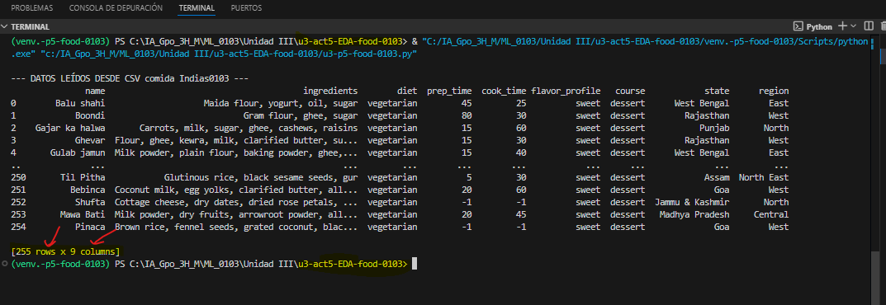
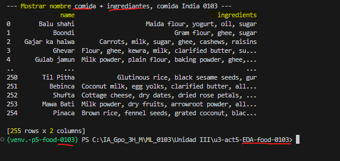

## Analisis exploratorio de datos
## Comida del pais India
## Santiago Medrano NC 0103
## -+-+- Importando datos del archivo csv comida de india  -+-+-

## -+-+-Mostrar nombre comida + ingrediantes-+-+-

## -+-+- tiempo de cocinado mostrar 10 registros con head -+-+-
